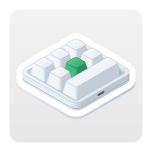

<p align="center"></p>

<h1 align="center">أداة إعداد لوحات مفاتيح الماكرو لنظام Linux</h1>

<p align="center">
  
  
  
  <a href="../LICENSE"></a>
</p>

<p align="center"><a href="../README.md">English</a> · <a href="README.ko.md">한국어</a> · <b>العربية</b> · <a href="README.de.md">Deutsch</a> · <a href="README.es.md">Español</a> · <a href="README.es-419.md">Español (Latinoamérica)</a> · <a href="README.fr.md">Français</a> · <a href="README.id.md">Bahasa Indonesia</a> · <a href="README.it.md">Italiano</a> · <a href="README.ja.md">日本語</a> · <a href="README.pl.md">Polski</a> · <a href="README.pt-BR.md">Português (Brasil)</a> · <a href="README.pt-PT.md">Português (Portugal)</a> · <a href="README.ru.md">Русский</a> · <a href="README.th.md">ไทย</a> · <a href="README.vi.md">Tiếng Việt</a> · <a href="README.zh-Hans.md">简体中文</a> · <a href="README.zh-Hant.md">繁體中文</a></p>

تطبيق لنظام Linux يكتب إعدادات المفاتيح على لوحات مفاتيح الماكرو الصغيرة بمنفذ USB — وهي اللوحات التي تُباع بدءًا من مقبض
واحد فقط وحتى 21 مفتاحًا، وبما يصل إلى أربعة مقابض. ولكل مفتاح ولكل إجراء من إجراءات المقبض (التدوير إلى اليسار، والضغط،
والتدوير إلى اليمين) يضبط التطبيق ضغطات المفاتيح أو مفتاح وسائط أو إجراء ماوس في الطبقات 1–3، ويضبط أيضًا إضاءة لوحة
المفاتيح. وهو نسخة Linux من تطبيق لنظام macOS بُني على القواعد نفسها، ويستخدم الأوامر نفسها.

<p align="center"></p>

| لوحة المفاتيح | التخطيط | قراءة الإعدادات | الانتظار | الإضاءة | جُرّبت فعليًا |
|---|---|---|---|---|---|
| `1189:8890` | تحدده أنت — المفاتيح (حتى 12)، والمفاتيح في كل صف، والمقابض (حتى 2) | لا | لا | ثلاثة أوضاع | نعم — 6 مفاتيح ومقبض واحد |
| الشركة المصنعة `1189` أو `514C`، المنتج `8840` · `8842` · `8830`–`8833` · `8850` · `8851`، ببرنامج ثابت أحدث | وفق ما تذكره لوحة المفاتيح — 26 تخطيطًا | عند التوصيل | قبل كل ضغطة | وضع واحد، ولون لكل مفتاح من المفاتيح 1–16 | نعم — `514C:8850`، 12 مفتاحًا ومقبضان |
| اللوحات نفسها، ببرنامج ثابت أقدم | وفق ما تذكره لوحة المفاتيح | عند التوصيل | انتظار واحد لكل مفتاح | لون ووضع | لا |
| اللوحات نفسها حين لا تذكر نوعها | تختاره أنت — 26 تخطيطًا | لا | لا | لون ووضع | لا |

لوحة المفاتيح `1189:8890` هي اللوحة التي تعمل معها «MINI KeyBoard»، أداة الشركة المصنعة لنظام Windows؛ أما البقية فهي
اللوحات التي يبحث عنها «MINI_KEYBOARD»، تطبيق الشركة المصنعة متعدد المنصات. ويستخدم التطبيق أوامر كلتا الأداتين. ومعظم
لوحات الفئة الثانية تذكر عدد مفاتيحها ومقابضها والبرنامج الثابت الذي تعمل به، فيرسم التطبيق التخطيط الذي كان سيرسمه
تطبيق الشركة المصنعة؛ أما اللوحة التي لا تذكر ذلك فتحصل على التخطيط الذي تختاره أنت من بين تلك التخطيطات. ولا يعرف تطبيق
الشركة المصنعة لوحة `1189:8890`، ولا ترسم أداتها الخاصة أي شكل، لذا فشكلها الحقيقي غير معروف: تُخبر أنت التطبيق بعدد
مفاتيحها ومقابضها وبعدد المفاتيح في كل صف، فيرسمها بترتيب منظم وفق ذلك.

يتوفر التطبيق بـ 18 لغة — الإنجليزية، والكورية، واليابانية، والصينية (المبسطة والتقليدية)، والألمانية، والإسبانية
(إسبانيا وأمريكا اللاتينية)، والفرنسية، والإيطالية، والبرتغالية (البرازيل والبرتغال)، والبولندية، والروسية،
والإندونيسية، والفيتنامية، والتايلاندية، والعربية — ويتبع لغة سطح المكتب. ويظهر بالإنجليزية في اللغات الأخرى.

الشيفرة المصدرية في هذا المستودع مرخّصة بترخيص MIT. أما أيقونة التطبيق — الموجودة في `data/icons/`، وكذلك الصورة المعروضة
في الأعلى — فمرخّصة بترخيص CC BY-SA 4.0 ([`LICENSES/CC-BY-SA-4.0.txt`](../LICENSES/CC-BY-SA-4.0.txt)).

## على macOS وWindows وLinux والويب

يتوفر MINIKeyboard في أربع نسخ مبنية على القواعد نفسها — الأوامر نفسها، واللغات الـ 18 نفسها. وتدعم التطبيقات الثلاثة لوحات المفاتيح نفسها، أما نسخة الويب، التي تعمل في المتصفح، فتدعمها جميعًا ما عدا `1189:8890`.

| المستودع | GitHub |
|---|---|
| **MINIKeyboardApple**<br>    | [github.com/hobbyworker/MINIKeyboardApple](https://github.com/hobbyworker/MINIKeyboardApple) |
| **MINIKeyboardWin**<br>    | [github.com/hobbyworker/MINIKeyboardWin](https://github.com/hobbyworker/MINIKeyboardWin) |
| **MINIKeyboardLinux**<br>    | [github.com/hobbyworker/MINIKeyboardLinux](https://github.com/hobbyworker/MINIKeyboardLinux) |
| **MINIKeyboardWeb**<br>    | [github.com/hobbyworker/MINIKeyboardWeb](https://github.com/hobbyworker/MINIKeyboardWeb) |

## التنزيل

افتح [me.hobbyworker.MINIKeyboard.flatpakref](https://mini-kb.hobbyworker.me/updates/linux/me.hobbyworker.MINIKeyboard.flatpakref) في مركز البرامج لديك، أو شغّل:

```sh
flatpak install --user https://mini-kb.hobbyworker.me/updates/linux/me.hobbyworker.MINIKeyboard.flatpakref
```

يضيف ذلك مستودع Flatpak الخاص بالتطبيق، ويجلب التثبيت الأول أيضًا بيئة تشغيل GNOME من Flathub. ومن ذلك الحين يجلب مركز
البرامج لديك — أو `flatpak update` — الإصدارات الجديدة. وتبقى إعداداتك كما هي.

يتوفر كل إصدار أيضًا في صفحة [Releases](https://github.com/hobbyworker/MINIKeyboardLinux/releases) على هيئة حزمة
Flatpak — `MINIKeyboard-<version>-x86_64.flatpak` لأجهزة Intel وAMD، و`-aarch64.flatpak` لأجهزة ARM — لجهاز كمبيوتر بلا
اتصال بالإنترنت، أو لإصدار بعينه. وتُثبَّت الحزمة باستخدام `flatpak install --user <file>`، ثم تتلقى تحديثاتها من المستودع
نفسه.

## السماح للتطبيق بفتح لوحة المفاتيح

لا يسمح Linux لأي تطبيق بفتح جهاز USB إلا إذا كانت هناك قاعدة udev تمنح هذا الجهاز للمستخدم الذي سجّل الدخول، ولا يستطيع
تطبيق Flatpak تثبيت قاعدة كهذه. وفي المرة الأولى يُعلمك التطبيق بأنه يحتاج إلى إذن الوصول، ويعرض **طريقة السماح…**
الأوامر التي تكتب القاعدة، مع زر لنسخها. شغّلها في الطرفية مرة واحدة، ثم أعد توصيل لوحة المفاتيح. وإذا استنسخت هذا
المستودع، فستجد القاعدة نفسها في [`data/60-minikeyboard.rules`](../data/60-minikeyboard.rules):

```sh
sudo install -m 644 data/60-minikeyboard.rules /etc/udev/rules.d/
sudo udevadm control --reload-rules
sudo udevadm trigger
```

- تُكتب الإعدادات على لوحة `1189:8890` مباشرةً عبر USB (libusb): فواجهة التكوين فيها لا تحتوي إلا على نقطة نهاية OUT، لذا
  لا يستحوذ عليها أي برنامج تشغيل.
- أما اللوحات الأخرى فيُكتب عليها عبر جهاز hidraw الخاص بواجهة USB الأولى فيها، كما يفعل تطبيق الشركة المصنعة. وتواصل
  لوحة المفاتيح الكتابة كالمعتاد في أثناء ذلك.

## البناء

```sh
make build    # target/release/minikeyboard، بحسب PREFIX (/usr/local ما لم يُحدَّد غيره)
make install  # بعد make build: البرنامج، والترجمات، وملف سطح المكتب، وmetainfo، والأيقونات، والتراخيص، إلى DESTDIR/PREFIX
make test     # اختبارات كل الحزم — لا تُفتح أي نافذة، ولا تُلمَس أي لوحة مفاتيح
make check    # rustfmt وclippy؛ والتحذيرات تُعامَل كأخطاء
make run      # بنية Debug مع ترجماتها
```

يتطلب البناء Rust 1.88 أو أحدث، وملفات التطوير لكل من GTK 4 وlibadwaita 1.7 أو أحدث وlibsoup 3 وlibusb 1.0 — على Debian
وUbuntu `libgtk-4-dev libadwaita-1-dev libsoup-3.0-dev libusb-1.0-0-dev`، وعلى Fedora
`gtk4-devel libadwaita-devel libsoup3-devel libusb1-devel` — و`msgfmt` من gettext للترجمات.

معرّف التطبيق (`me.hobbyworker.MINIKeyboard`) واسمه وروابطه خاصة به، وهي تطابق ملف سطح المكتب وmetainfo والأيقونات في
`data/`. أما المشروع المتفرع (fork) فيحدد قيمه الخاصة عند البناء: `MINIKEYBOARD_APP_ID` (وهو أيضًا اسم الأيقونة)،
و`MINIKEYBOARD_APP_NAME`، و`MINIKEYBOARD_COPYRIGHT`، و`MINIKEYBOARD_WEBSITE`، و`MINIKEYBOARD_ISSUE_URL`. ويستنتج
`make build` موضع الترجمات من `PREFIX`؛ ويتجاوزه `MINIKEYBOARD_LOCALE_DIR` وقت التشغيل، عند تجربة بنية ما.

ويمكن للتطبيق أيضًا أن يُعلمك بنفسه بالإصدارات الجديدة: فالبنية التي يُحدَّد لها `MINIKEYBOARD_UPDATE_FEED` تقرأ موجز RSS هذا
عند التشغيل ومرة كل يوم — ما لم يكن **التحقق من وجود تحديثات تلقائيًا** مُعطَّلًا في التفضيلات — وكذلك عند اختيار
**التحقق من وجود تحديثات…**، ثم تعرض شريطًا يحيل إلى صفحة تنزيل الإصدار الجديد. أما البنيات الرسمية للتطبيق فلا تستخدم
ذلك — إذ يجلب Flatpak تحديثاتها — لذا لا يوجد فيها عنصر القائمة هذا ولا هذا الإعداد.

تتيح لك القائمة الفرعية **المحاكي** تجربة التطبيق دون لوحة المفاتيح المعنية: اختر `1189:8890`، أو تخطيطًا ببرنامج ثابت
أحدث، أو لوحة مفاتيح لا تذكر نوعها، فيتصرف التطبيق كأنها موصولة — بالأوامر نفسها، ودون أن يُرسَل أي شيء عبر USB. وفي أثناء
استخدام إحداها، يشير إلى ذلك شريط برتقالي أعلى النافذة، وللرجوع اختر **العودة إلى لوحة مفاتيح USB**. وتتيح بنيات Debug
جميع الأنواع (معرّفات التقارير الأخرى للوحة `1189:8890`، والبرنامج الثابت الأقدم)، ومع `MINIKEYBOARD_SIMULATED_KEYBOARD`
(`8890-3` مثلًا) يبدأ التطبيق بإحداها. ويعرض **سجل الجهاز** كل تقرير مكتوب وكل رد.

## الاستخدام

1. وصّل لوحة المفاتيح عبر USB. يعثر عليها التطبيق، ويسأل لوحات الفئة الثانية عن نوعها؛ واللوحة التي تجيب تُقرأ إعداداتها
   فورًا.
2. إذا كانت لوحة المفاتيح لا تذكر شكلها، فسيُطلب منك في المرة الأولى تحديد تخطيطها — أحد تخطيطات تطبيق الشركة المصنعة، أو
   بالنسبة إلى `1189:8890` عدد مفاتيحها والمفاتيح في كل صف ومقابضها — وكيفية وضعها أمامك. ويتذكر التطبيق الأمرين كليهما
   لمعرّف USB هذا. ويمكنك تغييرهما لاحقًا باستخدام **الشكل…** و**تدوير** (Ctrl+T)؛ أما اللوحة التي ذكرت شكلها فيمكن
   تدويرها فقط.
3. اختر طبقة، ثم المفتاح أو إجراء المقبض في رسم لوحة المفاتيح.
4. عيّن له إجراءً:
   - **المفاتيح** — أبقِ مفاتيح التعديل مضغوطة (Ctrl، Alt، Shift، Super، والمفاتيح اليمنى منها أيضًا)، ثم انقر المفاتيح؛
     فكل نقرة تضيف ضغطة. ويحوّل الخيار **مفاتيح التعديل فقط** المفتاحَ إلى مفتاح تعديل. ويعرض **QWERTY** المفاتيح بترتيب
     لوحة مفاتيح كاملة الحجم، و**ABC** في مجموعات؛ ولا يمكن النقر إلا على المفاتيح التي يمكن تعيينها في لوحة المفاتيح.
   - **الوسائط المتعددة**، **الماوس** — يحل كل منهما محل الإجراء السابق للمفتاح.
   - **LED** — إضاءة الطبقة؛ وفي البرنامج الثابت الأحدث، حدد أحد المفاتيح 1–16 لتعيين لون له.
   - **التأخير** — في البرنامج الثابت الذي يحفظ فترات الانتظار.
5. يكتب الأمر **حفظ** (Ctrl+S) ما تغيّر. ويطلب الأمر **قراءة** (Ctrl+R) من لوحة المفاتيح التي تدعم القراءة ما تحمله من
   إعدادات.

في **التفضيلات** (Ctrl+,) تختار لغة الواجهة (واحدة من اللغات الـ 18، أو لغة سطح المكتب) والمظهر الفاتح أو الداكن؛ وفي
البنية التي لها موجز تحديثات، تضم صفحة «عام» فيها التحقق التلقائي من التحديثات. وفي **حول MINIKeyboard** تجد الإصدار
وتراخيص البرامج مفتوحة المصدر.

في **التفضيلات ▸ عام ▸ تجاوز أخطاء البرنامج الثابت** يوجد الخيار **منع تكرار المفاتيح بعد تغيير الإضاءة**، وهو مُفعَّل
افتراضيًا. فبعد حفظ الإضاءة، يكرر البرنامج الثابت في `1189:8890` أول ضغطة للمفتاح بلا توقف — ويحدث الأمر نفسه مع برنامج
الشركة المصنعة — لذا يرسل التطبيق بعد الإضاءة أمر حفظ إضافيًا لا يحتوي على أي مفتاح. وعند إيقاف الخيار، يرسل التطبيق ما
يرسله برنامج الشركة المصنعة فقط. كما أن هذه اللوحة تنسى إضاءتها عند فصلها.

## الهيكل

تقع القواعد في حزم (crates) تتجه اعتمادياتها إلى الداخل — والطبقة التي تمتد إلى الخارج لا تجتاز الترجمة البرمجية.

```
crates/
├── domain/        لوحات المفاتيح، والإجراءات، وعناصر التحكم في كل تخطيط، وما يمكن أن تحمله كل لوحة مفاتيح؛ والمنافذ؛ وحالات الاستخدام (المكتبة القياسية فقط)
├── datalayer/     أوامر كل لوحة مفاتيح والأرقام التي تُعرَّف بها عناصر التحكم فيها؛ والعثور عليها في sysfs والكتابة عبر USB (libusb) أو hidraw؛ ولوحات مفاتيح المحاكي
├── presentation/  نماذج العرض والقيم التي ترسمها الشاشات — هندسة التخطيطات، وجداول المفاتيح والألوان، وقاعدة udev (دون مجموعة أدوات رسومية)
├── ui/            GTK 4 وlibadwaita — لا ترى إلا presentation؛ وإشعار الإصدار الجديد (libsoup)
└── minikeyboard/  جذر التركيب (composition root): الحزمة الوحيدة التي ترى كل الحزم
po/                الترجمات، ملف واحد لكل لغة
data/              ملف سطح المكتب، وmetainfo، والأيقونات، وقاعدة udev
LICENSES/          ترخيص الأيقونة (CC BY-SA 4.0)
```

المعيار هو صفر تحذيرات. تُصلَح التحذيرات ولا تُعطَّل.

## القيود

- جُرّبت الكتابة حتى الآن على لوحتي مفاتيح في Fedora: لوحة `1189:8890` بستة مفاتيح ومقبض واحد، ولوحة `514C:8850` باثني عشر
  مفتاحًا ومقبضين ببرنامج ثابت أحدث، تُفتح عبر hidraw. أما لوحات المفاتيح الأخرى فيُكتب عليها كما يكتب عليها تطبيق الشركة
  المصنعة — والأوامر مطابقة لأوامر تطبيق macOS بايتًا بايتًا، وتثبّتها الاختبارات — لكن لم تُجرَّب أي منها بعد.
- لا تستطيع لوحة `1189:8890`، ولا لوحات المفاتيح التي لا تذكر نوعها، الإبلاغ عن إعداداتها، لذا لا يعرض التطبيق إلا ما
  ضُبط فيه.
- تُفتح لوحة مفاتيح واحدة في كل مرة. وعند توصيل عدة لوحات، تختار اللوحة المطلوبة بالزر المجاور لحالة الاتصال؛ ويفتح
  التطبيق اللوحة التي اختيرت في المرة السابقة، وإلا فأول لوحة يعثر عليها، مع تقديم لوحة `1189:8890` على غيرها.
- لا يتوفر تحريك الماوس ولا السحب.

## الترخيص

ترخيص MIT — انظر [LICENSE](../LICENSE). أيقونة التطبيق: CC BY-SA 4.0 — انظر
[LICENSES/CC-BY-SA-4.0.txt](../LICENSES/CC-BY-SA-4.0.txt).
