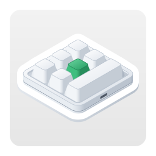
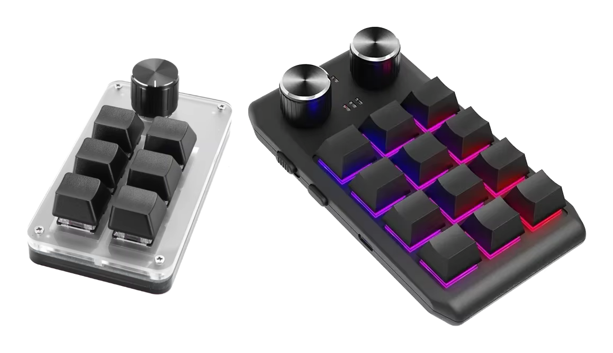

<p align="center"></p>

<h1 align="center">Configurador de teclados de macros para Linux</h1>

<p align="center">
  
  
  
  <a href="../LICENSE"></a>
</p>

<p align="center"><a href="../README.md">English</a> · <a href="README.ko.md">한국어</a> · <a href="README.de.md">Deutsch</a> · <b>Español</b> · <a href="README.fr.md">Français</a> · <a href="README.id.md">Bahasa Indonesia</a> · <a href="README.it.md">Italiano</a> · <a href="README.ja.md">日本語</a> · <a href="README.pl.md">Polski</a> · <a href="README.pt-BR.md">Português (Brasil)</a> · <a href="README.vi.md">Tiếng Việt</a> · <a href="README.zh-Hans.md">简体中文</a> · <a href="README.zh-Hant.md">繁體中文</a></p>

Una app para Linux que escribe la configuración de las teclas en pequeños teclados de macros USB. Se venden en
muchos tamaños: desde los que solo tienen un botón giratorio hasta los de 21 teclas, con hasta cuatro botones
giratorios. Para cada tecla y cada acción de un botón giratorio (girar a la izquierda, pulsar, girar a la derecha),
define en las capas 1–3 pulsaciones de teclas, una tecla multimedia o una acción del ratón, y también la
iluminación del teclado. Es la versión para Linux de una app para macOS creada con las mismas reglas, y usa los
mismos comandos.

<p align="center"></p>

| Teclado | Disposición | Lectura | Demora | Iluminación | Probado |
|---|---|---|---|---|---|
| `1189:8890` | la defines tú — teclas (hasta 12), teclas por fila, botones giratorios (hasta 2) | no | no | tres modos | sí — 6 teclas y un botón giratorio |
| fabricante `1189` o `514C`, producto `8840` · `8842` · `8830`–`8833` · `8850` · `8851`, firmware nuevo | según lo que indica el teclado — 26 disposiciones | al conectarlo | antes de cada pulsación | un modo y un color para cada una de las teclas 1–16 | sí — `514C:8850`, 12 teclas y 2 botones giratorios |
| los mismos, firmware antiguo | según lo que indica el teclado | al conectarlo | una por tecla | un color y un modo | no |
| los mismos, sin indicar su tipo | la eliges tú — 26 disposiciones | no | no | un color y un modo | no |

El `1189:8890` es el teclado con el que trabaja la herramienta de configuración para Windows del fabricante,
“MINI KeyBoard”; los demás son los que busca la app multiplataforma del fabricante, “MINI_KEYBOARD”. La app usa los
comandos de ambas herramientas. La mayoría de los teclados del segundo tipo indican cuántas teclas y botones
giratorios tienen y qué firmware usan, así que la app dibuja la misma disposición que dibujaría la app del
fabricante; si un teclado no lo indica, usa la que elijas entre esas disposiciones. La app del fabricante no conoce
el `1189:8890` y su propia herramienta no dibuja ninguna forma, así que no se sabe cuál es su forma real. Por eso,
tú indicas cuántas teclas y botones giratorios tiene y cuántas teclas hay en cada fila, y la app los dibuja tal
cual, bien ordenados.

La app está disponible en 13 idiomas: inglés, coreano, japonés, chino (simplificado y tradicional), alemán, español,
francés, italiano, portugués (Brasil), polaco, indonesio y vietnamita. Sigue el idioma del escritorio; en cualquier
otro idioma, aparece en inglés.

El código fuente de este repositorio tiene licencia MIT. El icono de la app —el de `data/icons/` y la imagen de
arriba— tiene licencia CC BY-SA 4.0 ([`LICENSES/CC-BY-SA-4.0.txt`](../LICENSES/CC-BY-SA-4.0.txt)).

## macOS, Windows y Linux

MINIKeyboard tiene tres ediciones hechas con las mismas reglas: los mismos teclados, los mismos comandos y los mismos 13 idiomas.

| Repositorio | GitHub |
|---|---|
| **MINIKeyboardApple**<br>    | [github.com/hobbyworker/MINIKeyboardApple](https://github.com/hobbyworker/MINIKeyboardApple) |
| **MINIKeyboardWin**<br>    | [github.com/hobbyworker/MINIKeyboardWin](https://github.com/hobbyworker/MINIKeyboardWin) |
| **MINIKeyboardLinux**<br>    | [github.com/hobbyworker/MINIKeyboardLinux](https://github.com/hobbyworker/MINIKeyboardLinux) |

## Descarga

Abre [me.hobbyworker.MINIKeyboard.flatpakref](https://mini-kb.hobbyworker.me/updates/linux/me.hobbyworker.MINIKeyboard.flatpakref) en el centro de software o
ejecuta:

```sh
flatpak install --user https://mini-kb.hobbyworker.me/updates/linux/me.hobbyworker.MINIKeyboard.flatpakref
```

Esto añade el repositorio Flatpak propio de la app, y la primera instalación también descarga el runtime de GNOME
desde Flathub. A partir de entonces, el centro de software —o `flatpak update`— trae las versiones nuevas. Tu
configuración se conserva.

Cada versión también está en [Releases](https://github.com/hobbyworker/MINIKeyboardLinux/releases) como paquete
Flatpak: `MINIKeyboard-<versión>-x86_64.flatpak` para Intel y AMD, y `-aarch64.flatpak` para ARM. Sirve para un PC sin
conexión a internet o cuando necesitas una versión concreta. El paquete se instala con
`flatpak install --user <archivo>` y después recibe las actualizaciones del mismo repositorio.

## Permitir que la app abra el teclado

Linux solo deja que una app abra un dispositivo USB si una regla de udev se lo asigna al usuario que ha iniciado
sesión, y un Flatpak no puede instalar esa regla. La primera vez, cuando la app te avisa de que necesita permiso de
acceso, **Cómo permitirlo…** muestra los comandos que escriben la regla y un botón para copiarlos. Ejecútalos una vez
en una terminal y vuelve a conectar el teclado. Si has clonado este repositorio, la misma regla está en
[`data/60-minikeyboard.rules`](../data/60-minikeyboard.rules):

```sh
sudo install -m 644 data/60-minikeyboard.rules /etc/udev/rules.d/
sudo udevadm control --reload-rules
sudo udevadm trigger
```

- El `1189:8890` se escribe directamente por USB (libusb): su interfaz de configuración solo tiene un endpoint OUT,
  así que ningún controlador se hace cargo de ella.
- Los demás teclados se escriben a través del dispositivo hidraw de su primera interfaz USB, como hace la app del
  fabricante. Mientras tanto, puedes seguir escribiendo con el teclado como siempre.

## Compilación

```sh
make build    # target/release/minikeyboard, para PREFIX (/usr/local si no se indica)
make install  # tras make build: el programa, las traducciones, el archivo .desktop, el metainfo, los iconos y las licencias, en DESTDIR/PREFIX
make test     # pruebas de todos los crates — no se abre ninguna ventana ni se toca ningún teclado
make check    # rustfmt y clippy; las advertencias son errores
make run      # una compilación Debug con sus traducciones
```

Necesita Rust 1.88 o posterior y los archivos de desarrollo de GTK 4, libadwaita 1.7 o posterior, libsoup 3 y
libusb 1.0: en Debian y Ubuntu, `libgtk-4-dev libadwaita-1-dev libsoup-3.0-dev libusb-1.0-0-dev`; en Fedora,
`gtk4-devel libadwaita-devel libsoup3-devel libusb1-devel`. Para las traducciones hace falta `msgfmt`, de gettext.

El ID de la app (`me.hobbyworker.MINIKeyboard`), su nombre y sus enlaces son los suyos propios y coinciden con el
archivo .desktop, el metainfo y los iconos de `data/`. Un fork indica los suyos al compilar: `MINIKEYBOARD_APP_ID`
(que también es el nombre del icono), `MINIKEYBOARD_APP_NAME`, `MINIKEYBOARD_COPYRIGHT`, `MINIKEYBOARD_WEBSITE` y
`MINIKEYBOARD_ISSUE_URL`. `make build` toma de `PREFIX` el lugar donde están las traducciones, y
`MINIKEYBOARD_LOCALE_DIR` lo sustituye al ejecutar la app, para probar una compilación.

La app también puede avisar ella misma de las versiones nuevas. Una compilación con `MINIKEYBOARD_UPDATE_FEED` lee ese
feed RSS al iniciarse y una vez al día —salvo que desactives **Buscar actualizaciones automáticamente** en
Preferencias— y también al pulsar **Buscar actualizaciones…**, y muestra un banner que lleva a la página de descarga
de la versión nueva. Las compilaciones propias de la app no lo usan —sus actualizaciones las trae Flatpak—, así que
no tienen ese elemento de menú ni ese ajuste.

El submenú **Simulador** permite probar la app sin el teclado en cuestión: elige un `1189:8890`, una disposición del
firmware más reciente o un teclado que no indique su tipo, y la app actúa como si estuviera conectado, con los mismos
comandos y sin enviar nada por USB. Mientras se usa, una barra naranja en la parte superior de la ventana lo indica, y
**Volver al teclado por USB** vuelve atrás. Las compilaciones Debug ofrecen todos los tipos (los otros ID de informe del
`1189:8890` y el firmware antiguo), y con `MINIKEYBOARD_SIMULATED_KEYBOARD` (por ejemplo, `8890-3`) la app arranca con
ese teclado. **Registro del dispositivo** muestra todos los informes escritos y todas las respuestas.

## Uso

1. Conecta el teclado por USB. La app lo encuentra y, si es del segundo tipo, le pregunta qué teclado es; si
   responde, lo lee enseguida.
2. Si un teclado no indica su forma, la primera vez eliges su disposición —una de las de la app del fabricante o,
   para el `1189:8890`, el número de teclas, de teclas por fila y de botones giratorios— y cómo está colocado delante
   de ti. La app recuerda ambas cosas para ese ID USB. Más adelante puedes cambiarlas con **Forma…** y **Girar**
   (Ctrl+T). Un teclado que indica su forma solo se puede girar.
3. Elige una capa y, en el dibujo del teclado, una tecla o una acción de un botón giratorio.
4. Asígnale una acción:
   - **Teclas** — mantén pulsadas las teclas de modificación (Ctrl, Alt, Shift, Super y las de la derecha) y haz
     clic en las teclas; cada clic añade una pulsación. **Solo modificadores** convierte la tecla en una tecla de
     modificación. **QWERTY** coloca las teclas como en un teclado completo y **ABC**, por grupos. Solo puedes hacer
     clic en las teclas que admite el teclado.
   - **Multimedia**, **Ratón** — sustituyen lo que hacía la tecla.
   - **LED** — la iluminación de la capa. En el firmware nuevo, elige una de las teclas 1–16 para darle un color.
   - **Demora** — en el firmware que guarda las demoras.
5. **Guardar** (Ctrl+S) escribe lo que ha cambiado. **Leer** (Ctrl+R) trae la configuración actual de los teclados
   que permiten leerla.

En **Preferencias** (Ctrl+,) eliges el idioma de la interfaz (uno de los 13 o el del escritorio) y el modo claro u
oscuro. En una compilación con feed de actualizaciones, su página General incluye la búsqueda automática de
actualizaciones. En **Acerca de MINIKeyboard** ves la versión y las licencias de código abierto.

En **Preferencias ▸ General ▸ Soluciones para fallos del firmware**, **Evitar la repetición de teclas tras cambiar la
iluminación** está activado de forma predeterminada. El firmware del `1189:8890` repite sin parar el primer carácter
de una tecla después de guardar la iluminación (el software del fabricante hace lo mismo), así que la app envía una
orden de guardado más, sin ninguna tecla, después de la iluminación. Si lo desactivas, la app envía solo lo mismo que
el software del fabricante. Además, este teclado olvida su iluminación al desconectarlo.

## Estructura

Las reglas están en crates cuyas dependencias apuntan solo hacia dentro: una capa que intente alcanzar algo de fuera
no compila.

```
crates/
├── domain/        teclados, acciones, los controles de cada disposición y lo que admite cada teclado; puertos; casos de uso (solo la biblioteca estándar)
├── datalayer/     los comandos de cada teclado y la numeración de sus controles; búsqueda del teclado en sysfs y escritura por USB (libusb) o hidraw; teclados simulados
├── presentation/  modelos de vista y los valores que dibujan las pantallas — la geometría de las disposiciones, tablas de teclas y colores, la regla de udev (sin toolkit)
├── ui/            GTK 4 y libadwaita — solo ve presentation; el aviso de versión nueva (libsoup)
└── minikeyboard/  la raíz de composición (composition root), el único crate que los ve todos
po/                traducciones, un archivo por idioma
data/              el archivo .desktop, el metainfo y los iconos, y la regla de udev
LICENSES/          la licencia del icono (CC BY-SA 4.0)
```

El objetivo es cero advertencias. Las advertencias se corrigen, no se desactivan.

## Limitaciones

- Hasta ahora, la escritura se ha probado en dos teclados, en Fedora: un `1189:8890` con seis teclas y un botón
  giratorio y un `514C:8850` con doce teclas y dos botones giratorios, con firmware nuevo, abierto mediante hidraw.
  Los demás teclados se escriben tal como lo hace la app de su fabricante —los comandos son los de la app para macOS,
  byte a byte, y las pruebas los fijan—, pero todavía no se ha comprobado ninguno con un teclado real.
- El `1189:8890` y los teclados que no indican su tipo no pueden informar de su configuración, así que la app solo
  muestra lo que se ha definido en ella.
- Un teclado abierto cada vez. Si hay varios conectados, el botón junto al estado de conexión elige cuál; la app abre
  el que se eligió la última vez o, si no, el primero que encuentra, empezando por un `1189:8890`.
- No hay acciones para mover el ratón ni para arrastrar.

## Licencia

MIT — consulta [LICENSE](../LICENSE). El icono de la app: CC BY-SA 4.0 — consulta
[LICENSES/CC-BY-SA-4.0.txt](../LICENSES/CC-BY-SA-4.0.txt).
