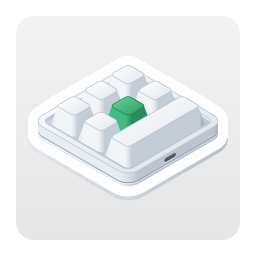

<p align="center"></p>

<h1 align="center">Configurador de teclados de macros para Linux</h1>

<p align="center">
  
  
  
  <a href="../LICENSE"></a>
</p>

<p align="center"><a href="../README.md">English</a> · <a href="README.ko.md">한국어</a> · <a href="README.de.md">Deutsch</a> · <a href="README.es.md">Español</a> · <a href="README.es-419.md">Español (Latinoamérica)</a> · <a href="README.fr.md">Français</a> · <a href="README.id.md">Bahasa Indonesia</a> · <a href="README.it.md">Italiano</a> · <a href="README.ja.md">日本語</a> · <a href="README.pl.md">Polski</a> · <a href="README.pt-BR.md">Português (Brasil)</a> · <b>Português (Portugal)</b> · <a href="README.ru.md">Русский</a> · <a href="README.th.md">ไทย</a> · <a href="README.vi.md">Tiếng Việt</a> · <a href="README.zh-Hans.md">简体中文</a> · <a href="README.zh-Hant.md">繁體中文</a></p>

Uma app para Linux que escreve as definições das teclas em pequenos teclados de macros USB. São vendidos em vários
tamanhos: desde os que têm só um botão rotativo até aos de 21 teclas, com até quatro botões rotativos. Para cada
tecla e cada ação de botão rotativo (rodar para a esquerda, premir, rodar para a direita), a app define nas
camadas 1–3 toques de teclas, uma tecla multimédia ou uma ação do rato, além da iluminação do teclado. É a versão
para Linux de uma app para macOS feita com as mesmas regras, e utiliza os mesmos comandos.

<p align="center"></p>

| Teclado | Disposição | Leitura | Atraso | Iluminação | Testado |
|---|---|---|---|---|---|
| `1189:8890` | definida por si — teclas (até 12), teclas por fila, botões rotativos (até 2) | não | não | três modos | sim — 6 teclas e um botão rotativo |
| fabricante `1189` ou `514C`, produto `8840` · `8842` · `8830`–`8833` · `8850` · `8851`, firmware novo | conforme o que o teclado indica — 26 disposições | ao ligar | antes de cada toque | um modo e uma cor para cada uma das teclas 1–16 | sim — `514C:8850`, 12 teclas e 2 botões rotativos |
| os mesmos, firmware antigo | conforme o que o teclado indica | ao ligar | um por tecla | uma cor e um modo | não |
| os mesmos, sem indicar o tipo | escolhida por si — 26 disposições | não | não | uma cor e um modo | não |

O `1189:8890` é o teclado com que trabalha a ferramenta de configuração para Windows do fabricante, “MINI KeyBoard”;
os restantes são os que a app multiplataforma do fabricante, “MINI_KEYBOARD”, procura. A app utiliza os comandos das
duas ferramentas. A maioria dos teclados do segundo tipo indica quantas teclas e botões rotativos tem e que firmware
utiliza, por isso a app desenha a mesma disposição que a app do fabricante desenharia; para um teclado que não o
indica, utiliza a disposição que escolher entre essas. A app do fabricante não conhece o `1189:8890`, e a própria
ferramenta deste não desenha nenhuma forma, por isso não se sabe qual é a forma real. Assim, indica quantas teclas e
botões rotativos tem e quantas teclas há em cada fila, e a app desenha tudo isso de forma organizada.

A app está disponível em 17 idiomas — inglês, coreano, japonês, chinês (simplificado e tradicional), alemão, espanhol
(Espanha e América Latina), francês, italiano, português (Brasil e Portugal), polaco, russo, indonésio, vietnamita e
tailandês — e segue o idioma do ambiente de trabalho. Em qualquer outro idioma, aparece em inglês.

O código-fonte deste repositório está sob a licença MIT. O ícone da app — o de `data/icons/` e a imagem no topo —
está sob a licença CC BY-SA 4.0 ([`LICENSES/CC-BY-SA-4.0.txt`](../LICENSES/CC-BY-SA-4.0.txt)).

## macOS, Windows, Linux e a web

O MINIKeyboard tem quatro edições feitas com as mesmas regras — os mesmos comandos, os mesmos 17 idiomas. As três apps aceitam os mesmos teclados, e a edição web, que funciona no navegador, todos menos o `1189:8890`.

| Repositório | GitHub |
|---|---|
| **MINIKeyboardApple**<br>    | [github.com/hobbyworker/MINIKeyboardApple](https://github.com/hobbyworker/MINIKeyboardApple) |
| **MINIKeyboardWin**<br>    | [github.com/hobbyworker/MINIKeyboardWin](https://github.com/hobbyworker/MINIKeyboardWin) |
| **MINIKeyboardLinux**<br>    | [github.com/hobbyworker/MINIKeyboardLinux](https://github.com/hobbyworker/MINIKeyboardLinux) |
| **MINIKeyboardWeb**<br>    | [github.com/hobbyworker/MINIKeyboardWeb](https://github.com/hobbyworker/MINIKeyboardWeb) |

## Transferir

Abra [me.hobbyworker.MINIKeyboard.flatpakref](https://mini-kb.hobbyworker.me/updates/linux/me.hobbyworker.MINIKeyboard.flatpakref) no centro de software ou execute:

```sh
flatpak install --user https://mini-kb.hobbyworker.me/updates/linux/me.hobbyworker.MINIKeyboard.flatpakref
```

Isto adiciona o repositório Flatpak da própria app, e a primeira instalação também transfere o runtime do GNOME do
Flathub. A partir daí, o centro de software — ou o `flatpak update` — traz as versões novas. As definições
mantêm-se.

Cada versão também está em [Releases](https://github.com/hobbyworker/MINIKeyboardLinux/releases) como pacote Flatpak:
`MINIKeyboard-<versão>-x86_64.flatpak` para Intel e AMD, e `-aarch64.flatpak` para ARM. Serve para um PC sem ligação
à internet ou quando precisa de uma versão específica. O pacote instala-se com `flatpak install --user <ficheiro>` e
depois recebe as atualizações do mesmo repositório.

## Permitir que a app abra o teclado

O Linux só deixa uma app abrir um dispositivo USB quando uma regra do udev o concede ao utilizador que iniciou a
sessão, e um Flatpak não consegue instalar essa regra. Na primeira vez, quando a app avisar que precisa de permissão
de acesso, **Como permitir…** mostra os comandos que escrevem a regra e um botão para os copiar. Execute-os uma vez
num terminal e volte a ligar o teclado. Se clonou este repositório, a mesma regra está em
[`data/60-minikeyboard.rules`](../data/60-minikeyboard.rules):

```sh
sudo install -m 644 data/60-minikeyboard.rules /etc/udev/rules.d/
sudo udevadm control --reload-rules
sudo udevadm trigger
```

- O `1189:8890` é escrito diretamente por USB (libusb): a interface de configuração dele só tem um endpoint OUT,
  por isso nenhum controlador o assume.
- Os restantes teclados são escritos através do dispositivo hidraw da primeira interface USB, como faz a app do
  fabricante. Entretanto, pode continuar a escrever normalmente com o teclado.

## Compilação

```sh
make build    # target/release/minikeyboard, para PREFIX (/usr/local se não for indicado)
make install  # depois de make build: o programa, as traduções, o ficheiro .desktop, o metainfo, os ícones e as licenças, em DESTDIR/PREFIX
make test     # testes de todos os crates — não se abre nenhuma janela nem se mexe em nenhum teclado
make check    # rustfmt e clippy; os avisos são erros
make run      # uma compilação Debug com as traduções
```

É preciso o Rust 1.88 ou posterior e os ficheiros de desenvolvimento do GTK 4, libadwaita 1.7 ou posterior,
libsoup 3 e libusb 1.0: no Debian e no Ubuntu, `libgtk-4-dev libadwaita-1-dev libsoup-3.0-dev libusb-1.0-0-dev`; no
Fedora, `gtk4-devel libadwaita-devel libsoup3-devel libusb1-devel`. Para as traduções, é preciso o `msgfmt` do
gettext.

O ID da app (`me.hobbyworker.MINIKeyboard`), o nome e as ligações são da própria app e correspondem ao
ficheiro .desktop, ao metainfo e aos ícones em `data/`. Um fork indica os seus na compilação: `MINIKEYBOARD_APP_ID`
(que também é o nome do ícone), `MINIKEYBOARD_APP_NAME`, `MINIKEYBOARD_COPYRIGHT`, `MINIKEYBOARD_WEBSITE` e
`MINIKEYBOARD_ISSUE_URL`. O `make build` define a partir de `PREFIX` o local onde ficam as traduções, e o
`MINIKEYBOARD_LOCALE_DIR`, no momento da execução, substitui-o — para experimentar uma compilação.

A app também pode avisar por si própria sobre versões novas. Uma compilação com `MINIKEYBOARD_UPDATE_FEED` lê esse
feed RSS ao arrancar e uma vez por dia — a menos que **Procurar atualizações automaticamente** esteja desativado em
Preferências — e também ao clicar em **Procurar atualizações…**, e mostra uma faixa de aviso que leva à página de
transferência da versão nova. As compilações da própria app não utilizam isto — as atualizações delas chegam pelo
Flatpak —, por isso não têm esse item de menu nem essa definição.

O submenu **Simulador** permite experimentar a app sem o teclado em questão: escolha um `1189:8890`, uma disposição
do firmware mais recente ou um teclado que não indique o tipo, e a app age como se estivesse ligado — com os mesmos
comandos, sem enviar nada por USB. Enquanto estiver em utilização, uma barra laranja no topo da janela avisa, e
**Voltar ao teclado ligado por USB** volta ao teclado real. As compilações Debug oferecem todos os tipos (os outros
IDs do relatório do `1189:8890`, o firmware antigo), e com `MINIKEYBOARD_SIMULATED_KEYBOARD` (por exemplo, `8890-3`)
a app arranca logo com esse teclado. **Registo do dispositivo** mostra todos os relatórios escritos e todas as
respostas.

## Como utilizar

1. Ligue o teclado por USB. A app encontra-o e, se for do segundo tipo, pergunta-lhe que teclado é; se ele
   responder, lê-o de imediato.
2. Na primeira vez, para um teclado que não indica a forma, define a disposição — uma das disposições da app do
   fabricante ou, no `1189:8890`, o número de teclas, de teclas por fila e de botões rotativos — e a posição em que
   fica à sua frente. A app guarda as duas coisas para esse ID USB. Depois, pode alterá-las com **Forma…** e
   **Rodar** (Ctrl+T). Um teclado que indicou a forma só pode ser rodado.
3. Escolha uma camada e, no desenho do teclado, uma tecla ou uma ação de botão rotativo.
4. Atribua uma ação:
   - **Teclas** — mantenha premidas as teclas modificadoras (Ctrl, Alt, Shift, Super e as do lado direito) e clique
     nas teclas; cada clique adiciona um toque. **Só modificadoras** transforma a tecla numa tecla modificadora.
     **QWERTY** dispõe as teclas como num teclado completo e **ABC**, em grupos. Só é possível clicar nas teclas que
     o teclado aceita.
   - **Multimédia**, **Rato** — substituem o que a tecla fazia.
   - **LED** — a iluminação da camada. No firmware novo, escolha uma das teclas 1–16 para lhe dar uma cor.
   - **Atraso** — no firmware que guarda os atrasos.
5. **Guardar** (Ctrl+S) escreve o que mudou. **Ler** (Ctrl+R) obtém a configuração atual dos teclados que permitem a
   leitura.

Em **Preferências** (Ctrl+,), escolhe o idioma da interface (um dos 17 ou o do ambiente de trabalho) e tons claros
ou escuros. Numa compilação com feed de atualizações, a página Geral tem a procura automática de atualizações. Em
**Acerca do MINIKeyboard**, vê a versão e as licenças de código aberto.

Em **Preferências ▸ Geral ▸ Contornar erros do firmware**, **Evitar a repetição de teclas após alterar a
iluminação** vem ativado por predefinição. O firmware do `1189:8890` repete sem parar o primeiro carácter de uma
tecla depois de a iluminação ser guardada (o software do fabricante faz o mesmo), por isso a app envia mais um
comando de guardar, sem nenhuma tecla, depois da iluminação. Desativado, a app envia apenas o mesmo que o software
do fabricante. Este teclado também se esquece da iluminação quando é desligado.

## Estrutura

As regras ficam em crates cujas dependências apontam só para dentro: uma camada que tente alcançar algo de fora não
compila.

```
crates/
├── domain/        teclados, ações, os controlos de cada disposição e o que cada teclado comporta; as portas; casos de utilização (só a biblioteca padrão)
├── datalayer/     os comandos de cada teclado e a numeração dos controlos; encontrar o teclado no sysfs e escrever por USB (libusb) ou hidraw; teclados simulados
├── presentation/  view models e os valores que os ecrãs desenham — a geometria das disposições, tabelas de teclas e cores, a regra do udev (sem toolkit)
├── ui/            GTK 4 e libadwaita — só vê presentation; o aviso de versão nova (libsoup)
└── minikeyboard/  a composition root: o único sítio que conhece todos os crates
po/                traduções, um ficheiro por idioma
data/              o ficheiro .desktop, o metainfo e os ícones, e a regra do udev
LICENSES/          a licença do ícone (CC BY-SA 4.0)
```

Zero avisos é a regra. Os avisos corrigem-se, não se desativam.

## Limitações

- Até agora, a escrita foi testada em dois teclados, no Fedora: um `1189:8890` com seis teclas e um botão rotativo
  e um `514C:8850` com doze teclas e dois botões rotativos, com firmware novo, aberto através do hidraw. Os restantes
  teclados são escritos como a app do fabricante os escreve — os comandos são os da app para macOS, byte a byte, e
  os testes fixam-nos —, mas nenhum deles foi ainda testado num teclado real.
- O `1189:8890` e os teclados que não indicam o tipo não conseguem indicar a configuração atual, por isso a app mostra
  só o que foi definido nela.
- Um teclado aberto de cada vez. Com vários ligados, o botão ao lado do estado da ligação escolhe qual; a app abre o
  escolhido da última vez ou, se não houver, o primeiro que encontrar — um `1189:8890` primeiro.
- Não há ações para mover o rato nem para arrastar.

## Licença

MIT — consulte [LICENSE](../LICENSE). O ícone da app: CC BY-SA 4.0 — consulte
[LICENSES/CC-BY-SA-4.0.txt](../LICENSES/CC-BY-SA-4.0.txt).
