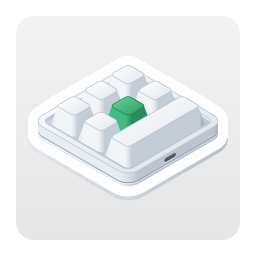

<p align="center"></p>

<h1 align="center">Конфигуратор макроклавиатур для Linux</h1>

<p align="center">
  
  
  
  <a href="../LICENSE"></a>
</p>

<p align="center"><a href="../README.md">English</a> · <a href="README.ko.md">한국어</a> · <a href="README.de.md">Deutsch</a> · <a href="README.es.md">Español</a> · <a href="README.fr.md">Français</a> · <a href="README.id.md">Bahasa Indonesia</a> · <a href="README.it.md">Italiano</a> · <a href="README.ja.md">日本語</a> · <a href="README.pl.md">Polski</a> · <a href="README.pt-BR.md">Português (Brasil)</a> · <a href="README.pt-PT.md">Português (Portugal)</a> · <b>Русский</b> · <a href="README.th.md">ไทย</a> · <a href="README.vi.md">Tiếng Việt</a> · <a href="README.zh-Hans.md">简体中文</a> · <a href="README.zh-Hant.md">繁體中文</a></p>

Приложение для Linux, которое записывает настройки клавиш в маленькие USB-макроклавиатуры. Такие клавиатуры продаются
в самых разных вариантах — от одной-единственной ручки до 21 клавиши, а ручек у них бывает до четырёх. Для каждой
клавиши и каждого действия ручки (поворот влево, нажатие, поворот вправо) приложение задаёт на слоях 1–3 нажатия
клавиш, медиаклавишу или действие мыши, а также подсветку клавиатуры. Это Linux-версия приложения для macOS,
созданного по тем же правилам, и команды у неё те же.

<p align="center"></p>

| Клавиатура | Компоновка | Считывание | Задержки | Подсветка | Проверено |
|---|---|---|---|---|---|
| `1189:8890` | задаёте вы — клавиши (до 12), клавиш в ряду, ручки (до 2) | нет | нет | три режима | да — 6 клавиш и ручка |
| производитель `1189` или `514C`, продукт `8840` · `8842` · `8830`–`8833` · `8850` · `8851`, новая прошивка | по данным клавиатуры — 26 компоновок | сразу при подключении | перед каждым нажатием | режим и цвет для каждой из клавиш 1–16 | да — `514C:8850`, 12 клавиш и 2 ручки |
| те же, старая прошивка | по данным клавиатуры | сразу при подключении | одна на клавишу | цвет и режим | нет |
| те же, не сообщающие свой тип | выбираете вы — 26 компоновок | нет | нет | цвет и режим | нет |

Клавиатура `1189:8890` — та, с которой работает утилита производителя для Windows «MINI KeyBoard»; остальные — те,
которые ищет кроссплатформенное приложение производителя «MINI_KEYBOARD». Приложение использует команды обоих
инструментов. Большинство клавиатур второго вида сообщают, сколько у них клавиш и ручек и какая у них прошивка,
и приложение рисует ту же компоновку, что нарисовало бы приложение производителя; для клавиатуры, которая этого не
сообщает, используется выбранная вами компоновка из их числа. Приложение производителя не знает `1189:8890`,
а собственная утилита этой клавиатуры не рисует никакой формы, поэтому её настоящая форма неизвестна: вы указываете,
сколько у неё клавиш и ручек и сколько клавиш в ряду, а приложение аккуратно рисует именно такое расположение.

Приложение доступно на 16 языках — английском, корейском, японском, китайском (упрощённом и традиционном), немецком,
испанском, французском, итальянском, португальском (Бразилия и Португалия), польском, русском, индонезийском,
вьетнамском и тайском — и следует языку окружения рабочего стола. Для остальных языков используется английский.

Исходный код в этом репозитории распространяется по лицензии MIT. Значок приложения — в `data/icons/` и на изображении
вверху — распространяется по лицензии CC BY-SA 4.0 ([`LICENSES/CC-BY-SA-4.0.txt`](../LICENSES/CC-BY-SA-4.0.txt)).

## macOS, Windows, Linux и веб

MINIKeyboard выходит в четырёх версиях, созданных по одним и тем же правилам, — те же команды, те же 16 языков. Три приложения поддерживают одни и те же клавиатуры, а веб-версия, работающая в браузере, — все, кроме `1189:8890`.

| Репозиторий | GitHub |
|---|---|
| **MINIKeyboardApple**<br>    | [github.com/hobbyworker/MINIKeyboardApple](https://github.com/hobbyworker/MINIKeyboardApple) |
| **MINIKeyboardWin**<br>    | [github.com/hobbyworker/MINIKeyboardWin](https://github.com/hobbyworker/MINIKeyboardWin) |
| **MINIKeyboardLinux**<br>    | [github.com/hobbyworker/MINIKeyboardLinux](https://github.com/hobbyworker/MINIKeyboardLinux) |
| **MINIKeyboardWeb**<br>    | [github.com/hobbyworker/MINIKeyboardWeb](https://github.com/hobbyworker/MINIKeyboardWeb) |

## Загрузка

Откройте [me.hobbyworker.MINIKeyboard.flatpakref](https://mini-kb.hobbyworker.me/updates/linux/me.hobbyworker.MINIKeyboard.flatpakref) в центре приложений или выполните:

```sh
flatpak install --user https://mini-kb.hobbyworker.me/updates/linux/me.hobbyworker.MINIKeyboard.flatpakref
```

Будет добавлен собственный Flatpak-репозиторий приложения, а при первой установке также загрузится среда выполнения
GNOME из Flathub. После этого новые версии приносит центр приложений — или `flatpak update`. Ваши настройки
сохраняются.

Каждая версия также выложена на странице [Releases](https://github.com/hobbyworker/MINIKeyboardLinux/releases) в виде
пакета Flatpak — `MINIKeyboard-<версия>-x86_64.flatpak` для Intel и AMD, `-aarch64.flatpak` для ARM — для компьютера
без подключения к интернету или если нужна определённая версия. Пакет устанавливается командой
`flatpak install --user <файл>`, а затем получает обновления из того же репозитория.

## Доступ приложения к клавиатуре

Linux позволяет приложению открыть USB-устройство, только если правило udev предоставляет его вошедшему в систему
пользователю, а приложение во Flatpak установить такое правило не может. В первый раз приложение сообщает, что ему
нужен доступ: **Как разрешить…** показывает команды, которые записывают правило, и кнопку для их копирования.
Выполните их один раз в терминале, а затем снова подключите клавиатуру. В клоне этого репозитория то же правило лежит
в [`data/60-minikeyboard.rules`](../data/60-minikeyboard.rules):

```sh
sudo install -m 644 data/60-minikeyboard.rules /etc/udev/rules.d/
sudo udevadm control --reload-rules
sudo udevadm trigger
```

- Клавиатура `1189:8890` записывается напрямую по USB (libusb): у её интерфейса настройки есть только конечная точка
  OUT, поэтому его не занимает ни один драйвер.
- Остальные записываются через устройство hidraw своего первого USB-интерфейса, как это делает приложение
  производителя. Клавиатура при этом продолжает печатать как обычно.

## Сборка

```sh
make build    # target/release/minikeyboard для PREFIX (по умолчанию /usr/local)
make install  # после make build: программа, переводы, desktop-файл, metainfo, значки и лицензии — в DESTDIR/PREFIX
make test     # тесты всех крейтов — окна не открываются, клавиатуры не затрагиваются
make check    # rustfmt и clippy; предупреждения считаются ошибками
make run      # отладочная сборка вместе с переводами
```

Нужны Rust 1.88 или новее и файлы для разработки GTK 4, libadwaita 1.7 или новее, libsoup 3 и libusb 1.0 — в Debian
и Ubuntu `libgtk-4-dev libadwaita-1-dev libsoup-3.0-dev libusb-1.0-0-dev`, в Fedora
`gtk4-devel libadwaita-devel libsoup3-devel libusb1-devel`, — а для переводов `msgfmt` из gettext.

ID приложения (`me.hobbyworker.MINIKeyboard`), название и ссылки принадлежат самому приложению и совпадают
с desktop-файлом, metainfo и значками в `data/`. Форк задаёт свои при сборке: `MINIKEYBOARD_APP_ID` (это также имя
значка), `MINIKEYBOARD_APP_NAME`, `MINIKEYBOARD_COPYRIGHT`, `MINIKEYBOARD_WEBSITE` и `MINIKEYBOARD_ISSUE_URL`. Где
искать переводы, `make build` определяет по `PREFIX`; переменная `MINIKEYBOARD_LOCALE_DIR` при запуске переопределяет
это место (когда нужно опробовать сборку).

Приложение может и само сообщать о новых версиях: сборка, которой задана переменная `MINIKEYBOARD_UPDATE_FEED`, читает
этот RSS-канал при запуске и раз в день — если в окне «Параметры» не выключен переключатель
**Автоматически проверять наличие обновлений**, — а также по команде **Проверить наличие обновлений…** и показывает
баннер со ссылкой на страницу загрузки новой версии. Собственные сборки приложения этим не пользуются — обновления им
доставляет Flatpak, — поэтому у них нет ни такого пункта меню, ни такого параметра.

Подменю **Симулятор** позволяет попробовать приложение без самой клавиатуры: выберите `1189:8890`, компоновку на новой
прошивке или клавиатуру, которая не сообщает свой тип, и приложение будет вести себя так, будто она подключена, —
с теми же командами, но ничего не отправляя по USB. Пока симулятор используется, об этом сообщает оранжевая полоса
вверху окна, а **Вернуться к USB-клавиатуре** возвращает к настоящей клавиатуре. В сборках Debug доступны все варианты
(другие ID отчёта `1189:8890`, старая прошивка), а с `MINIKEYBOARD_SIMULATED_KEYBOARD` (например, `8890-3`) приложение
сразу запускается с одним из них. **Журнал устройства** показывает все записанные отчёты и все ответы.

## Использование

1. Подключите клавиатуру по USB. Приложение находит её, а у клавиатуры второго вида запрашивает тип; если клавиатура
   отвечает, её настройки сразу считываются.
2. Если клавиатура не сообщает свою форму, в первый раз приложение просит выбрать компоновку — одну из компоновок
   приложения производителя, а для `1189:8890` число клавиш, клавиш в ряду и ручек — и то, как клавиатура лежит перед
   вами. Приложение запоминает и то и другое для этого USB ID. Позже их можно изменить командами **Форма…**
   и **Повернуть** (Ctrl+T); клавиатуру, которая сообщила свою форму, можно только поворачивать.
3. Выберите слой, а затем на изображении клавиатуры — клавишу или действие ручки.
4. Назначьте действие:
   - **Клавиши** — удерживайте модификаторы (Ctrl, Alt, Shift, Super, а также правые) и щёлкайте по клавишам; каждый
     щелчок добавляет нажатие. **Только модификаторы** превращает клавишу в клавишу-модификатор. **QWERTY**
     располагает клавиши как на полноразмерной клавиатуре, **ABC** — группами; щёлкнуть можно только по тем клавишам,
     которые принимает клавиатура.
   - **Мультимедиа**, **Мышь** — заменяют прежнее действие клавиши.
   - **LED** — подсветка слоя; на новой прошивке выберите одну из клавиш 1–16, чтобы задать ей цвет.
   - **Задержка** — на прошивке, которая хранит задержки.
5. **Сохранить** (Ctrl+S) записывает изменения. **Считать** (Ctrl+R) получает текущие настройки с клавиатуры, которая
   поддерживает считывание.

**Параметры** (Ctrl+,) позволяют выбрать язык интерфейса (один из 16 или язык окружения рабочего стола) и светлое или
тёмное оформление; в сборке с каналом обновлений на их странице «Основные» есть и автоматическая проверка обновлений.
Пункт **О приложении «MINIKeyboard»** показывает версию и лицензии открытого ПО.

В разделе **Параметры ▸ Основные ▸ Обход ошибок прошивки** параметр
**Предотвращать повтор клавиш после изменения подсветки** по умолчанию включён. После сохранения подсветки прошивка
`1189:8890` бесконечно повторяет первый символ клавиши — с программой производителя происходит то же самое, — поэтому
после подсветки приложение отправляет ещё одну команду сохранения, без клавиш. Если параметр выключен, приложение
отправляет только то же, что и программа производителя. Кроме того, эта клавиатура забывает подсветку, когда её
отключают.

## Структура

Правила находятся в крейтах, зависимости которых направлены только внутрь, — слой, который тянется наружу, не
компилируется.

```
crates/
├── domain/        клавиатуры, действия, элементы управления каждой компоновки и то, что может хранить каждая клавиатура; порты; сценарии использования (только стандартная библиотека)
├── datalayer/     команды каждой клавиатуры и нумерация её элементов управления; поиск клавиатуры в sysfs и запись по USB (libusb) или через hidraw; клавиатуры симулятора
├── presentation/  модели представления и значения, которые рисуют экраны, — геометрия компоновок, таблицы клавиш и цветов, правило udev (без тулкита)
├── ui/            GTK 4 и libadwaita — видит только presentation; уведомление о новой версии (libsoup)
└── minikeyboard/  composition root: единственный крейт, который видит все остальные
po/                переводы, по файлу на язык
data/              desktop-файл, metainfo и значки, а также правило udev
LICENSES/          лицензия значка (CC BY-SA 4.0)
```

Ноль предупреждений — обязательное требование. Предупреждения исправляют, а не отключают.

## Ограничения

- Запись пока проверена в Fedora на двух клавиатурах: `1189:8890` с шестью клавишами и ручкой и `514C:8850`
  с двенадцатью клавишами и двумя ручками на новой прошивке; вторую приложение открывает через hidraw. Остальные
  клавиатуры записываются так же, как их записывает приложение производителя, — команды байт в байт совпадают
  с командами приложения для macOS, и тесты это фиксируют, — но ни одну из этих клавиатур ещё не проверяли на реальном
  устройстве.
- Клавиатура `1189:8890` и те, что не сообщают свой тип, не могут передать свои настройки, поэтому приложение
  показывает только то, что было задано в нём самом.
- Одновременно открыта только одна клавиатура. Если подключено несколько, нужную выбирают кнопкой рядом с состоянием
  подключения; приложение открывает ту, что была выбрана в прошлый раз, а если такой нет — первую найденную, причём
  сначала `1189:8890`.
- Перемещения мыши и перетаскивания нет.

## Лицензия

MIT — см. [LICENSE](../LICENSE). Значок приложения: CC BY-SA 4.0 — см.
[LICENSES/CC-BY-SA-4.0.txt](../LICENSES/CC-BY-SA-4.0.txt).
